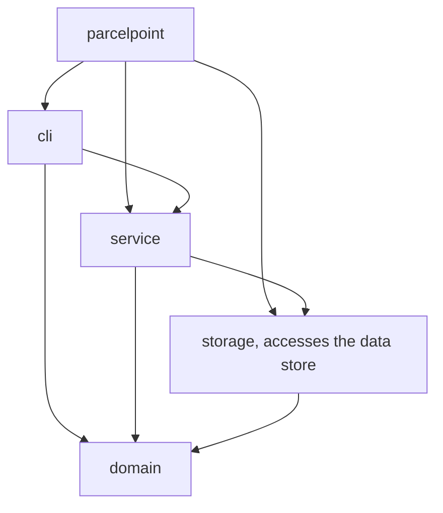
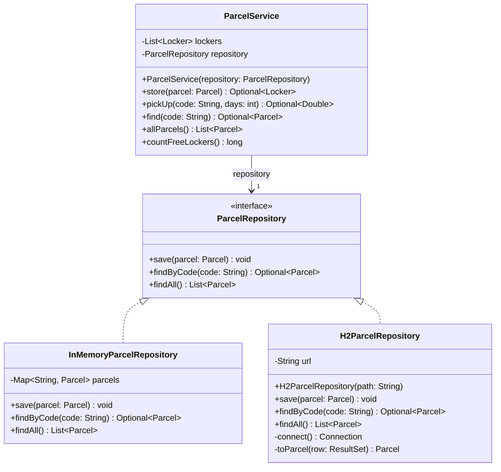
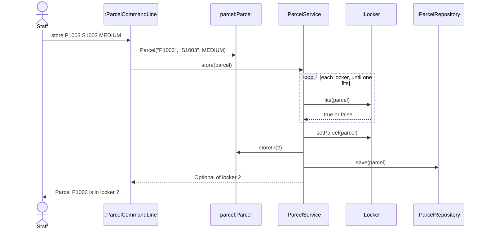

# Lab Report, Designing the Data Management Layer with H2

Repository URL:

## Tools

| Item | Version or name |
| --- | --- |
| JDK | |
| Maven | |
| IDE | |
| AI tool and exact model, if you used one | |

## Part 0. From a store in memory to H2

Commit of the starter, before any change: c1e8c13

0.3 Your prediction for `staff`, written before the second run: I think `staff` will show no parcels and say all 3 lockers are free, because I did not see the program save anything to a file, so the parcels probably only existed while the first run was open.

Output of the second run, for `staff` and `quit`:

```text
> staff
Free lockers: 3
> quit
```

State in one sentence where you think the parcels of the first run were kept.

The parcels of the first run were kept only in the memory of the running program, so they were lost as soon as the program ended.

0.5 The line of Main that you would change to keep the parcels somewhere else:

```java
ParcelRepository repository = new InMemoryParcelRepository();
```

0.6 Commit of the switch to H2: 188344a

0.7 Output of `SELECT * FROM PARCEL;` after you stored two parcels:

```text
sql> SELECT * FROM PARCEL;
CODE  | STUDENT_ID | PARCEL_SIZE | STATUS | LOCKER_NUMBER
P1001 | S1001      | SMALL       | STORED | 1
P1002 | S1002      | LARGE       | STORED | 3
(2 rows, 7 ms)
```

0.8 Explain why ParcelPoint could not start while the H2 Shell was open, and identify the class that wrote the message `Cannot create the PARCEL table`.

H2 is an embedded database, so the database file belongs to the program that opened it, and H2 locks the file `parcelpoint.mv.db` while it is open. The H2 Shell still had the database open, so when ParcelPoint tried to connect, H2 refused with `Database may be already in use` (the file is locked). The message `Cannot create the PARCEL table` was written by `H2ParcelRepository`: its constructor catches the `SQLException` from H2 and throws an `IllegalStateException` with that message, and the H2 error is shown below it as the `Caused by` line.

0.9 Explain why `staff` shows no parcel while `find` shows each one, and why all three lockers look free.

`find` uses `findByCode` in `H2ParcelRepository`, which really runs `SELECT * FROM PARCEL WHERE CODE = ?` on the database, so it finds both parcels. `staff` uses `findAll`, but `findAll` is still a TODO that just returns an empty list (`List.of()`) without reading the database, so `staff` lists nothing. All three lockers look free because the lockers live only in the memory of `ParcelService`, and its constructor fills them back in by calling `repository.findAll()` when the program starts. Since `findAll` returns nothing, no parcel is put back into any locker, so every locker starts empty.

0.11 Your findAll method:

```java
@Override
public List<Parcel> findAll() {
    String sql = "SELECT * FROM PARCEL ORDER BY CODE";
    List<Parcel> parcels = new ArrayList<>();
    try (Connection connection = connect();
         PreparedStatement statement = connection.prepareStatement(sql);
         ResultSet row = statement.executeQuery()) {
        while (row.next()) {
            parcels.add(toParcel(row));
        }
    } catch (SQLException e) {
        throw new IllegalStateException("Cannot read the parcels", e);
    }
    return parcels;
}
```

Commit that adds findAll: 8b3675c

0.12 Output of `SELECT * FROM PARCEL;` after the pickup:

```text
sql> SELECT * FROM PARCEL;
CODE  | STUDENT_ID | PARCEL_SIZE | STATUS    | LOCKER_NUMBER
P1001 | S1001      | SMALL       | PICKED_UP | null
P1002 | S1002      | LARGE       | STORED    | 3
(2 rows, 7 ms)
```

0.13 Optional. Describe what `find P9999'OR'1'='1` showed while the SQL was joined from strings, and what it showed after you put the placeholder back.

While the SQL was joined from strings, `find P9999` correctly said `No parcel with code P9999`, but `find P9999'OR'1'='1` showed `P1001, S1001, SMALL, PICKED_UP`, even though no parcel has that code. The quotes I typed closed the text in the SQL and added the condition `'1'='1'`, so H2 ran `SELECT * FROM PARCEL WHERE CODE = 'P9999'OR'1'='1'`, which is true for every row, and `findByCode` showed the first row (SQL injection). After I put the `?` placeholder and `statement.setString(1, code)` back, the same input showed `No parcel with code P9999'OR'1'='1`, because H2 now compares CODE with the whole text I typed as one value, so no row matches.

## Part A. Model the design

A1 Complete the flowchart with one node for each package and one arrow for each dependency, from the package that uses to the package that is used. Mark the package that accesses the data store.



State whether cli depends on storage, and explain why.

No, cli does not depend on storage. ParcelCommandLine imports only classes from domain and service, and it reaches the parcels only by calling ParcelService, which in turn uses the ParcelRepository interface in storage. Only Main (in the package parcelpoint) names a storage class directly, because it creates the repository and passes it to ParcelService, so the command line never needs to know where or how the parcels are kept.

A2 Complete the class diagram of the data management layer with ParcelService, the interface ParcelRepository with its three operations, and the two classes that implement it.



A3 Draw a sequence diagram for the command `store P1003 S1003 MEDIUM`, from the staff member to the repository. Show each message as an operation of the class that receives it.



Explain why the last lifeline is the interface ParcelRepository rather than H2ParcelRepository.

ParcelService only knows its field `repository`, whose type is the interface ParcelRepository, so the message `save(parcel)` is sent to whatever object stands behind that interface. ParcelService never names H2ParcelRepository, and Main decides which class it gets (Dependency Inversion), so the same sequence is true whether the parcels go to H2 or to the store in memory. Showing H2ParcelRepository would tie the diagram to one data store, which the design deliberately avoids.

## Part B. Design questions

1. Identify the files that you changed to move from the store in memory to H2, and explain why no other class had to change. Use the terms of this course.

   I changed only `Main.java`: one import line and the line that creates the repository, which now creates `H2ParcelRepository` instead of `InMemoryParcelRepository` (`H2ParcelRepository.java` was already in the starter, and I only finished `findAll` later). No other class had to change because `ParcelService` depends on the `ParcelRepository` interface, not on a concrete class, and it receives the repository through its constructor (dependency injection). This is the Dependency Inversion Principle: the interface is the boundary of the data management layer, so the business layer and `cli` above it never see SQL or know which data store is used, and `Main` is the one place that chooses it.

2. The PARCEL table stores the size of a parcel as SMALL, MEDIUM or LARGE rather than as 1, 2 or 3. Identify the type of connascence between ParcelSize and the table in each case, and explain which one is weaker.

   Storing the names SMALL, MEDIUM and LARGE gives connascence of name, because the table and `ParcelSize` only have to agree on the names, which `ParcelSize.valueOf` reads back in `toParcel`. Storing 1, 2 or 3 would give connascence of convention (and of position if the number came from the order of the enum values), because both sides would have to agree on what each number means. Connascence of name is weaker: the values are easy to read in the table, and reordering the enum or adding a new size does not silently change the meaning of rows that are already stored.

3. Project Phase 2 asks for a data store that needs no separate server. Explain why an embedded database such as H2 meets this rule, and describe the limit of an embedded database that Step 0.8 showed.

   H2 runs inside our own program as a library (the one dependency in `pom.xml`) and keeps its data in a file, `parcelpoint.mv.db`, so there is no database server to install or start, and `CREATE TABLE IF NOT EXISTS` creates the table on the first run. The limit shown in Step 0.8 is that the database belongs to the program that opened it: H2 locks the file, so only one program can use it at a time. While the H2 Shell had it open, ParcelPoint could not start and failed with `Database may be already in use`.

4. State the data store that you would choose for your Project Phase 2 team, files or an embedded database, the requirement that drives the choice, and the package that will access it.

   I would choose an embedded database, H2. The requirement that drives the choice is that the data must stay after the program ends while needing no separate server, and H2 also lets us look up and update single records with SQL, for example by their key, instead of reading and rewriting a whole file each time. Only our `storage` package will access the data store, through repository interfaces with H2 classes behind them, so the rest of the code stays independent of H2 and `Main` creates the repositories.

## AI usage declaration

| AI tool and exact model | Date | Purpose | Files or answers it produced or changed | How you checked its output |
| --- | --- | --- | --- | --- |
| Claude Code, Claude Opus 5.5 (claude-opus-5-5) | 2026-11-15 | Explain the lab instructions and help set up the tools | A summary of the lab sheet; installed JDK 21 and Maven with Homebrew and set JAVA_HOME | Ran `java -version` and `mvn -version` and checked that both show Java 21 |
| Claude Code, Claude Opus 5.5 (claude-opus-5-5) | 2026-11-15 | Run Part 0 and make the Git commits | Ran Steps 0.1 to 0.13, changed the two lines of `Main.java` (0.6), made the commits, and pasted the outputs into the report | Compared every output with the screens in the lab sheet; checked `git log` for the commit codes; checked that the broken `findByCode` of 0.13 was restored and not committed |
| Claude Code, Claude Opus 5.5 (claude-opus-5-5) | 2026-11-15 | Write findAll | The `findAll` method in `H2ParcelRepository.java` (0.11) | Built with `mvn package` and checked that `staff` lists P1001 and P1002 with `Free lockers: 1`, as in the lab sheet; compared it with the steps of `findByCode` |
| Claude Code, Claude Opus 5.5 (claude-opus-5-5) | 2026-11-15 | Draft written answers | The answers to 0.3, 0.5, 0.8, 0.9, 0.13, A1, A3 and Part B questions 1 to 4 | Read each answer against the code and the lab sheet (for 0.8, the constructor of `H2ParcelRepository`; for 0.9, `findAll` and the constructor of `ParcelService`) |
| Claude Code, Claude Opus 5.5 (claude-opus-5-5) | 2026-11-15 | Draw the Mermaid diagrams | The package diagram (A1), class diagram (A2) and sequence diagram (A3) | Checked the A1 arrows against the import lines of every file; checked A3 by running `store P1003 S1003 MEDIUM`, which put the parcel in locker 2 as in the diagram; rendered the diagrams on mermaid.live |
